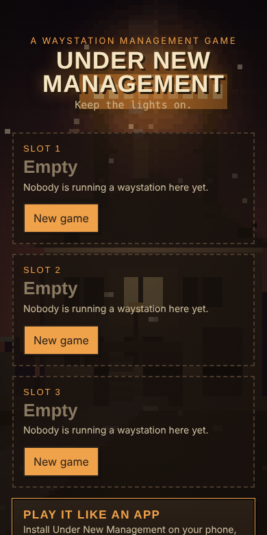
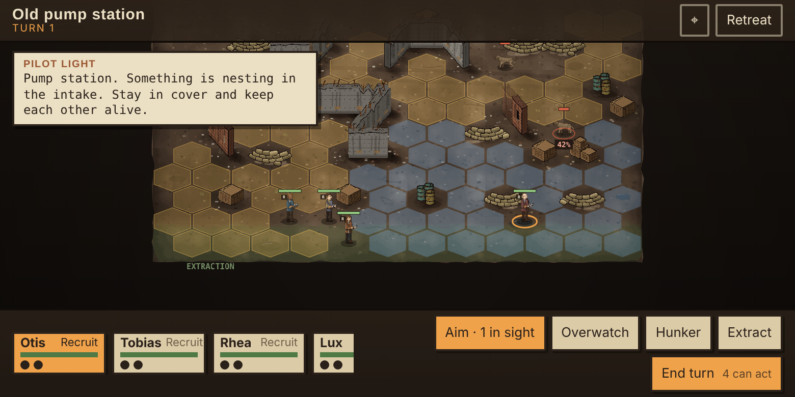

# Under New Management

*Run a waystation at the end of the world. Keep the lights on.*

A post-apocalyptic management game with XCOM-style tactical missions, by **Burnt Pixel Studios**.
Repair and expand a roadside waystation, hire and train a crew, keep travelers fed and the warlords
placated, then send your squad out on turn-based hex missions or hold the line when raiders come.

 

## Play

- **Browser**: open the hosted copy (GitHub Pages; see below), or build and open `dist/under-new-management.html`.
- **Install as an app**: on the hosted copy, use the main menu's *How to install* button (Android/Chrome:
  Install app; iPhone/iPad: Share -> Add to Home Screen; desktop: the install icon in the address bar).
  Installed, it runs full screen and works offline. Saves stay on the device.
- Plays in portrait and landscape on phones, foldables, tablets and desktop.

## Build

Needs only Python 3.

```bash
python3 build.py
```

Outputs `dist/under-new-management.html` (one self-contained file) and `dist/pwa/` (the installable copy).
See `CLAUDE.md` for the source layout, tests and conventions, and `docs/DESIGN.md` for the full game design.

## Deploy

`.github/workflows/pages.yml` builds the game and publishes `dist/pwa` to GitHub Pages on every push
to `main`. Enable it once in the repo: **Settings -> Pages -> Source: GitHub Actions**.

## License

Copyright (c) 2026 Burnt Pixel Studios. All rights reserved.
